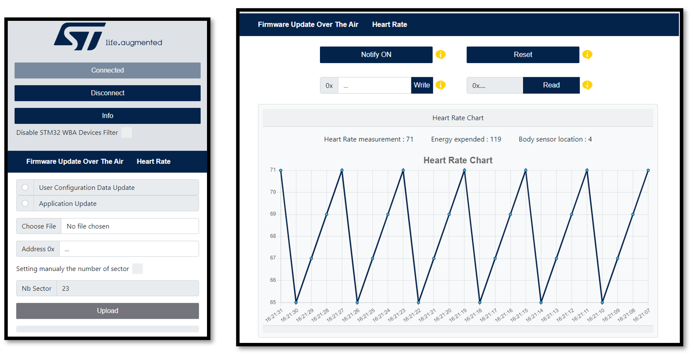
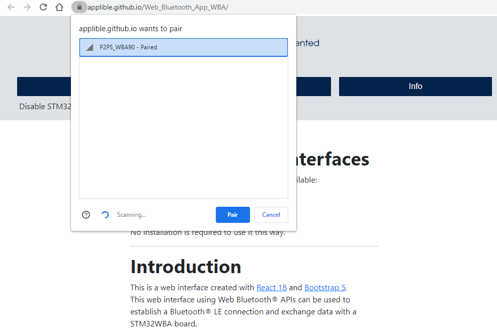
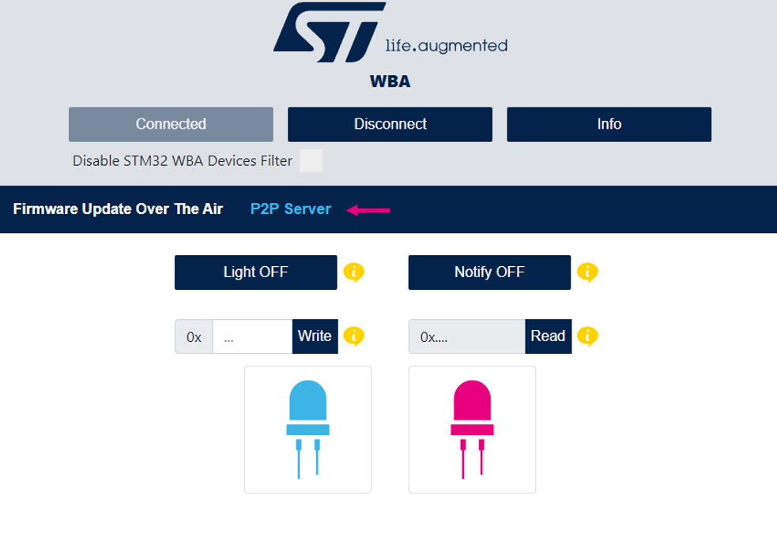
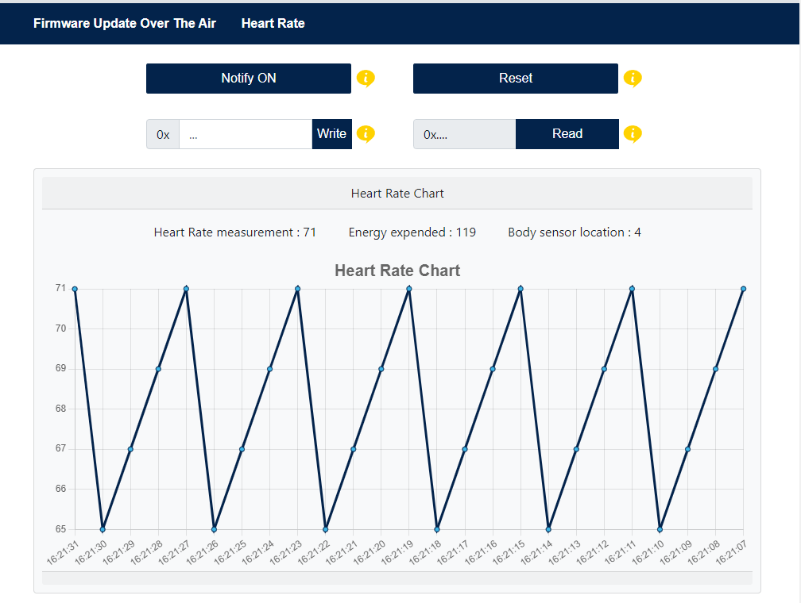
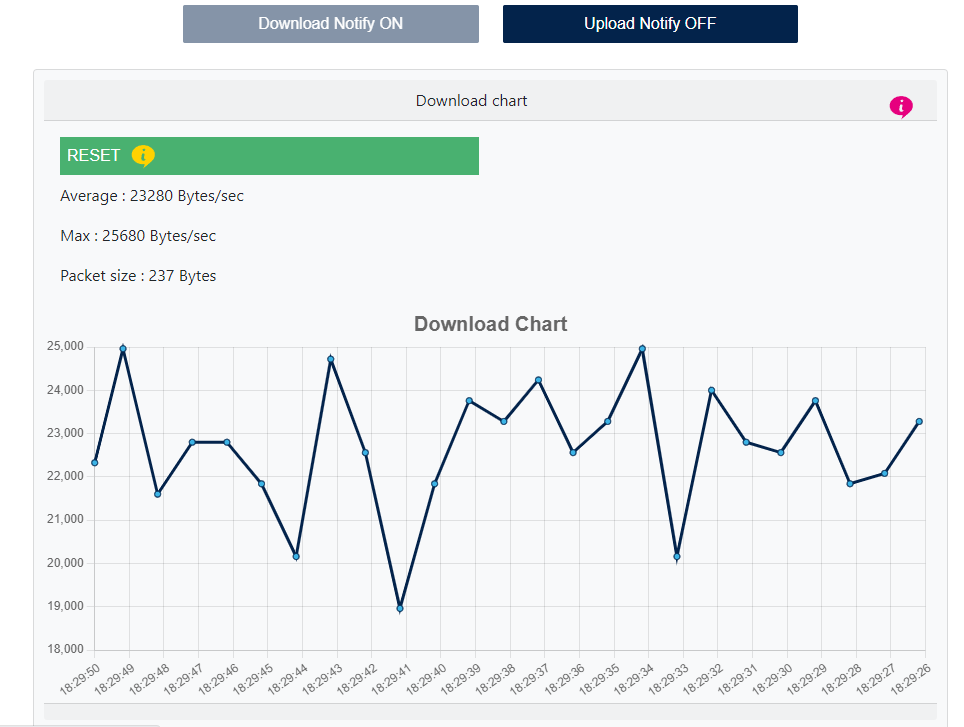
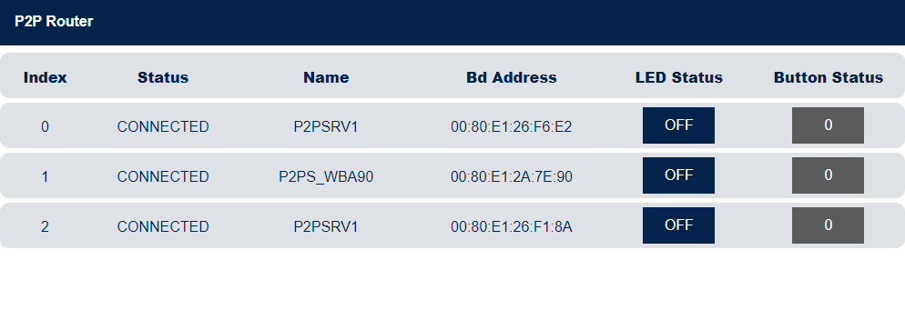
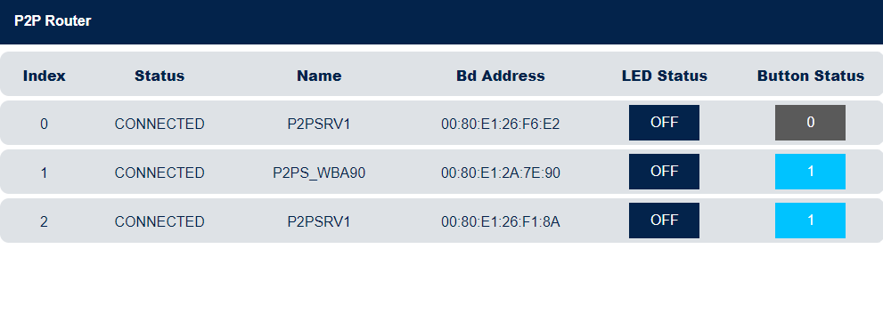
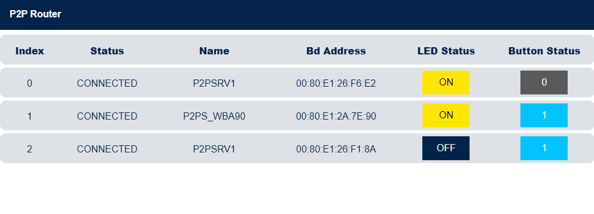
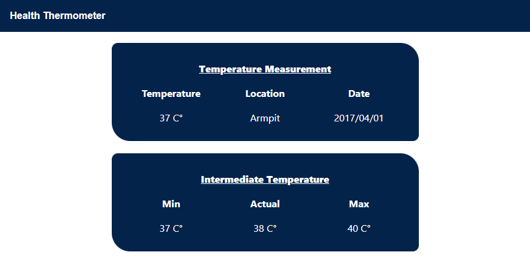

# **STM32WBA Web Bluetooth® App Interfaces**

Two GitHub pages hosting the web app are available:
-   [Web Bluetooth® **HOME PAGE**](https://applible.github.io/ST-Web-Bluetooth/ "https://applible.github.io/ST-Web-Bluetooth/").
-   [Web Bluetooth® **STM32WB**](https://AppliBLE.github.io/Web_Bluetooth_App_WB "https://AppliBLE.github.io/Web_Bluetooth_App_WB").
  
No installation is required to use it this way.

***

# **Introduction**

This is a web interface created with [React 18](https://reactjs.org/ "https://reactjs.org/") and [Bootstrap 5](https://getbootstrap.com/ "https://getbootstrap.com/").  
This web interface uses Web Bluetooth® APIs to establish a Bluetooth® LE connection and exchange data with an STM32WBA board.

Here is the list of STM32WBA applications supported by this Bluetooth® web application:

- [Peer To Peer Server](https://github.com/STMicroelectronics/STM32CubeWBA/tree/main/Projects/NUCLEO-WBA65RI/Applications/BLE/BLE_p2pServer)
- [Peer To Peer Router](https://github.com/STMicroelectronics/STM32CubeWBA/tree/main/Projects/NUCLEO-WBA65RI/Applications/BLE/BLE_p2pRouter)
- [HeartRate](https://github.com/STMicroelectronics/STM32CubeWBA/tree/main/Projects/NUCLEO-WBA65RI/Applications/BLE/BLE_HeartRate)
- [Firmware Update Over The Air](https://github.com/STMicroelectronics/STM32CubeWBA/tree/main/Projects/NUCLEO-WBA65RI/Applications/BLE/BLE_ApplicationInstallManager)
- [Data Throughput](https://github.com/STMicroelectronics/STM32CubeWBA/tree/main/Projects/NUCLEO-WBA65RI/Applications/BLE/BLE_DataThroughput_Server)
- [Health Thermometer](https://github.com/STMicroelectronics/STM32CubeWBA/tree/main/Projects/NUCLEO-WBA65RI/Applications/BLE/BLE_HealthThermometer)
- [Electrocardiogram](https://github.com/STMicroelectronics/STM32CubeWBA/tree/main/Projects/NUCLEO-WBA65RI/Applications/BLE/BLE_GenericHealth_ECG_ota)
- [BLE OEMiROT FOTA](https://github.com/stm32-hotspot/STM32WBA-BLE-OEMiROT-FOTA)
- [Continuous Glucose Monitoring](https://github.com/stm32-hotspot/STM32WBA-BLE-ContinuousGlucoseMonitoring)
- [Doorlock](https://github.com/stm32-hotspot/STM32WBA-BLE-TFM-Doorlock)
- [Blood Pressure](https://github.com/stm32-hotspot/STM32WBA-BLE-BloodPressure)
- [Running Speed and Cadence](https://github.com/stm32-hotspot/STM32WBA-BLE-RunningSpeedAndCadence)
- [Weight Scale](https://github.com/stm32-hotspot/STM32WBA-BLE-WeightScale)
- [AI Fan Control](https://github.com/stm32-hotspot/STM32WBA-BLE-AI-Fan-Control)
- Solar Panel Demo

Example of the interface when a connection is established with Firmware Update Over The Air application and HeartRate application

***

# **Setup**

## Hardware requirements

To use the web interface, the following STM32WBA board is required:
- [NUCLEO-WBA5x](https://www.st.com/en/evaluation-tools/nucleo-wba55cg.html "https://www.st.com/en/evaluation-tools/nucleo-wba55cg.html")

A PC or a smartphone is required to open the web interface in a browser.

## Software requirements

For more information about STM32CubeWBA Software Architecture click [here](https://wiki.st.com/stm32mcu/wiki/Connectivity:STM32CubeWBA_SW_Architecture "https://wiki.st.com/stm32mcu/wiki/Connectivity:STM32CubeWBA_SW_Architecture")

Refer to [UM2237](https://www.st.com/resource/en/user_manual/dm00403500-stm32cubeprogrammer-software-description-stmicroelectronics.pdf "https://www.st.com/resource/en/user_manual/dm00403500-stm32cubeprogrammer-software-description-stmicroelectronics.pdf") to learn how to install and use STM32CubeProgrammer.  

For more information about Bluetooth® LE please refer to the [STMicroelectronics  Wiki](https://wiki.st.com/stm32mcu/wiki/Connectivity:BLE_overview "https://wiki.st.com/stm32mcu/wiki/Connectivity:BLE_overview").

***

# **User's guide**

## **Peer To Peer Server**  

The P2P Server application demonstrates a bidirectional Bluetooth® LE communication between a client and a server. The P2P Server interface proposes a set of buttons to interact with the connected device. A reboot panel is available only if a P2P Server service with the reboot OTA characteristic is detected on the device (see the Firmware Update Over The Air section to have more information related to OTA).  

### **Requirements**

Example with the [NUCLEO-WBA5x](https://www.st.com/en/evaluation-tools/nucleo-wba55cg.html "https://www.st.com/en/evaluation-tools/nucleo-wba55cg.html") board.  

[BLE_p2pServer](https://github.com/STMicroelectronics/STM32CubeWBA/tree/main/Projects/NUCLEO-WBA55CG/Applications/BLE/BLE_p2pServer/Binary "https://github.com/STMicroelectronics/STM32CubeWBA/tree/main/Projects/NUCLEO-WBA55CG/Applications/BLE/BLE_p2pServer/Binary") binary file has to be flashed in the microcontroller.  

### **Follow these steps to learn how to use the P2P Server application**

**Step 1.** Power on the STM32WBA board with the P2P Server application flashed and activate Bluetooth® on your machine.  
**Step 2.** Open [this](https://applible.github.io/Web_Bluetooth_App_WBA "https://applible.github.io/Web_Bluetooth_App_WBA") web page in your browser.  
**Step 3.** Click the Connect button, select `P2PS_WBAxx` in the device list, and click Pair.   
  
**Step 4.** Click P2P Server to show the interface and **read the tooltips**.  
*You are now connected.*  
*You can now interact with the connected device.*  
  

For more information about this application, please refer to [STM32WBA P2P Server](https://wiki.st.com/stm32mcu/wiki/Connectivity:STM32WBA_Peer_To_Peer "https://wiki.st.com/stm32mcu/wiki/Connectivity:STM32WBA_Peer_To_Peer").

***

## **Firmware Update Over The Air (OTA)**

The Firmware Update Over The Air (OTA) application allows a remote device to update the current application. 

### **Requirements**

Example with the [NUCLEO-WBA5x](https://www.st.com/en/evaluation-tools/nucleo-wba55cg.html "https://www.st.com/en/evaluation-tools/nucleo-wba55cg.html") board.  

The [BLE_ApplicationInstallManager](https://github.com/AppliBLE/STM32WBA_Binaries/tree/master/BLE_ApplicationInstallManager "https://github.com/AppliBLE/STM32WBA_Binaries/tree/master/BLE_ApplicationInstallManager") application, associated with a Bluetooth® LE application that embeds an OTA service, manages firmware updates over the air for Bluetooth® LE applications.

The BLE_ApplicationInstallManager application must run with Bluetooth® LE applications that embed an OTA service, such as [BLE_HeartRate_ota]() or [BLE_p2pServer_ota]() applications.

BLE_ApplicationInstallManager is loaded at the memory address *0x08000000*.
BLE_HeartRate_ota or BLE_p2pServer_ota application is loaded at the memory address *0x08006000*.

### **Follow the next steps to learn how to use the application Firmware Update Over The Air.**  
**Step 1.** Power on the STM32WBA board with the OTA application flashed and enable Bluetooth® on your machine.   
**Step 2.** Open [this](https://applible.github.io/Web_Bluetooth_App_WBA "https://applible.github.io/Web_Bluetooth_App") web page in your browser.  
**Step 3.** Click the Connect button, select your device from the list, and click Pair.  
*You are now connected*  
**Step 4.** Choose between updating the User Configuration Data and the Application.  
**Step 5.** Select the binary to be downloaded.
**Step 6. (Optional)** Choose the first sector address from which the file will be written.  
**Step 7.** Click on the upload button and wait for the disconnection.  
  
*Congratulations, the new Application/Wireless stack is running and can be connected*  

For more information about this application, please refer to [STM32WBA FUOTA](https://wiki.st.com/stm32mcu/wiki/Connectivity:STM32WBA_FUOTA "https://wiki.st.com/stm32mcu/wiki/Connectivity:STM32WBA_FUOTA").

***

## **HeartRate**

The HeartRate application measures heart rate data and other information like the body sensor location and the energy expended. The HeartRate interface proposes a set of buttons and text input to interact with the connected device and a chart displaying the heart rate data received. A reboot panel is available only if a HeartRate service with the reboot OTA characteristic is detected on the device (see the Firmware Update Over The Air section to have more information related to OTA).  

### **Requirements**

Example with the [NUCLEO-WBA5x](https://www.st.com/en/evaluation-tools/nucleo-wba55cg.html "https://www.st.com/en/evaluation-tools/nucleo-wba55cg.html") board.  

[BLE_HeartRate](https://github.com/STMicroelectronics/STM32CubeWBA/tree/main/Projects/NUCLEO-WBA55CG/Applications/BLE/BLE_HeartRate/Binary "https://github.com/STMicroelectronics/STM32CubeWBA/tree/main/Projects/NUCLEO-WBA55CG/Applications/BLE/BLE_HeartRate/Binary") binary file has to be flashed in the microcontroller.  

### **Follow these steps to learn how to use the HeartRate application**

**Step 1.** Power on the STM32WBA board with the HeartRate application flashed and activate Bluetooth® on your machine.  
**Step 2.** Open [this](https://applible.github.io/Web_Bluetooth_App_WBA "https://applible.github.io/Web_Bluetooth_App_WBA") web page in your browser.  
**Step 3.** Click the Connect button, select `HRSTM` in the device list, and click Pair.  
*You are now connected.*  
**Step 4.** Click HeartRate to show the interface and read the tooltips.  
*You can now interact with the connected device.*  
  

For more information about this application, please refer to [STM32WBA Heart Rate](https://wiki.st.com/stm32mcu/wiki/Connectivity:STM32WBA_HeartRate#Software_and_system_requirements "https://wiki.st.com/stm32mcu/wiki/Connectivity:STM32WBA_HeartRate#Software_and_system_requirements").

***

## **Data Throughput**

The Data Throughput application measures the upload (data transfer from web interface to the connected device) and download (data transfer from the connected device to the web interface) throughput between the web app and the connected device. The Data Throughput interface proposes two panels, one to display the uploaded data and the other the downloaded data. Each panel has a chart of the data throughput and a button to reset the chart, the upload panel has also a button to start or stop the uploading of data.  

### **Requirements**

Example with the [NUCLEO-WBA5x](https://www.st.com/en/evaluation-tools/nucleo-wba55cg.html "https://www.st.com/en/evaluation-tools/nucleo-wba55cg.html") board.  

[BLE_DataThroughput](https://github.com/AppliBLE/STM32WBA_Binaries/tree/master/BLE_DataThroughput_Server "https://github.com/AppliBLE/STM32WBA_Binaries/tree/master/BLE_DataThroughput_Server") binary file has to be flashed in the microcontroller.  

### **Follow these steps to learn how to use the Data Throughput application**

**Step 1.** Power on the STM32WBA board with the Data Throughput application flashed and activate Bluetooth® on your machine.  
**Step 2.** Open [this](https://applible.github.io/Web_Bluetooth_App_WBA/ "https://applible.github.io/Web_Bluetooth_App_WBA") web page in your browser.  
**Step 3.** Click the Connect button, select `DT_SERVER` in the device list, and click Pair.  
*You are now connected.*  
**Step 4.** Click Data Throughput to show the interface and read the tooltips.  
*You can now interact with the connected device.*  
  

For more information about this application, please refer to [STM32WBA Data Throughput](https://wiki.st.com/stm32mcu/wiki/Connectivity:STM32WBA_Data_Throughput "https://wiki.st.com/stm32mcu/wiki/Connectivity:STM32WBA_Data_Throughput").

***
## **Peer To Peer Router**

The P2P Router application demonstrates STM32WBA acting at the same time as both: Bluetooth® LE central and peripheral, GATT server and client.

The P2P Router application scans to connect to P2P Server devices and accepts connections from the ST Web Bluetooth® app. It routes Bluetooth® LE messages received from both sides.

### **Requirements**

Example setup: one [NUCLEO-WBA5x](https://www.st.com/en/evaluation-tools/nucleo-wba55cg.html "https://www.st.com/en/evaluation-tools/nucleo-wba55cg.html") board as a P2P Router, two NUCLEO-WBA5x boards and one [P-NUCLEO-WB55](https://www.st.com/en/evaluation-tools/p-nucleo-wb55.html "https://www.st.com/en/evaluation-tools/p-nucleo-wb55.html") as P2P Servers.  

You need a P2P Router running on an STM32WBA5x and at least one other STM32WBAxx / STM32WB Nucleo board running a P2P Server application.

### **Follow these steps to learn how to use the P2P Router application**

**Step 1.** Power the P2P Router board with the P2P Router application flashed and power the other boards with the P2P Server applications.  
**Step 2.** Activate Bluetooth® on your machine.   
**Step 3.** Open [this](https://applible.github.io/Web_Bluetooth_App/ "https://applible.github.io/Web_Bluetooth_App") web page in your browser.  
**Step 4.** Click the Connect button, select `P2PR_WBAxx` in the device list, and click Pair.  
*You are now connected.*  
**Step 5.** Click P2P Router to show the interface and click the Start button.
*You can now interact with the connected device.*  
**Step 6.** Power up to seven P2P Server devices near the P2P Router device.
**Step 7.** On each click of B1, the P2P Router will scan and then connect to a surrounding P2P Server device.
**Step 8.** On the Web Bluetooth® interface you can see devices appearing.
  
**Step 9.** On a P2P Server device, a click on B1 sends a notification to the P2P Router. 
This notification message is forwarded to the smartphone and displayed on the interface.

**Step 10.** On the Web Bluetooth® interface, click the Light button to write a message to the corresponding P2P Server device. This write message is first sent to the P2P Router and then routed to its destination.

For more information about this application, please refer to [STM32WBA P2P Router](https://wiki.st.com/stm32mcu/wiki/Connectivity:STM32WBA_Peer_To_Peer "https://wiki.st.com/stm32mcu/wiki/Connectivity:STM32WBA_Peer_To_Peer").

***
## **Health Thermometer**

The Health Thermometer Profile is used to enable a data collection device to obtain data from a thermometer sensor that exposes the Health Thermometer Service.

This specification is compatible with any Bluetooth® core specification host [3] that includes the Generic Attribute Profile (GATT) specification and the Bluetooth® Low Energy Controller specification.

### **Requirements**

Example with the [NUCLEO-WBA5x](https://www.st.com/en/evaluation-tools/nucleo-wba55cg.html "https://www.st.com/en/evaluation-tools/nucleo-wba55cg.html") board.  

[BLE_HealthThermometer](https://github.com/AppliBLE/STM32WBA_Binaries/tree/master/BLE_HealthThermometer/ "https://github.com/AppliBLE/STM32WBA_Binaries/tree/master/BLE_HealthThermometer") binary file has to be flashed in the microcontroller.  

### **Follow the next steps to learn how to use the application Health Thermometer**

**Step 1.** Power on the STM32WBA board with the Health Thermometer application flashed in and activate the bluetooth® on your machine.   
**Step 2.** Open [this](https://applible.github.io/Web_Bluetooth_App_WBA/ "https://applible.github.io/Web_Bluetooth_App_WBA") web page in your browser.  
**Step 3.** Click on the connect button then select HT_xx in the device list and click pair.  
*You are now connected*  
**Step 4.** Click on Health Thermometer to show the interface. 
  

For more information about this application, please refer to [STM32WBA Health Thermometer](https://github.com/AppliBLE/STM32WBA_Binaries/tree/master/BLE_HealthThermometer/ "https://github.com/AppliBLE/STM32WBA_Binaries/tree/master/BLE_HealthThermometer").

***

## **Solar DEMO**

The Solar Demo profile is used by SolarDemo running on STM32WBAx. The Solar Demo interface provides a button to enable or disable notifications.

### **Requirements**

**Step 1.** Start the STM32WBA board with the Solar Demo application flashed in and activate Bluetooth® on your machine.
**Step 2.** Open [this](https://applible.github.io/Web_Bluetooth_App_WBA/ "https://applible.github.io/Web_Bluetooth_App_WBA") web page in your browser.
**Step 3.** Click the Connect button, select `Solar_xx` in the device list, and click Pair.
*You are now connected.*
**Step 4.** Click Solar Panel to show the interface.

***

# **Troubleshooting**  

Caution : Issues and the pull-requests are not supported to submit problems or suggestions related to the software delivered in this repository. This example is being delivered as-is, and not necessarily supported by ST.

For any other question related to the product, the hardware performance or characteristics, the tools, the environment, you can submit it to the ST Community on the STM32WBA MCUs related [page](https://community.st.com/s/topic/0TO0X000000BSqSWAW/stm32-mcus "https://community.st.com/s/topic/0TO0X000000BSqSWAW/stm32-mcus").
